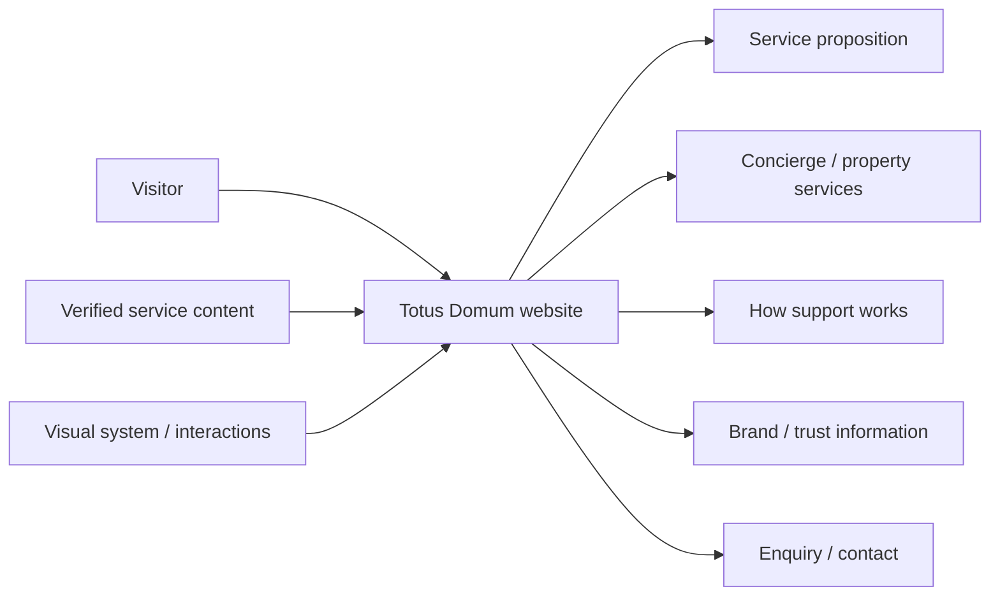
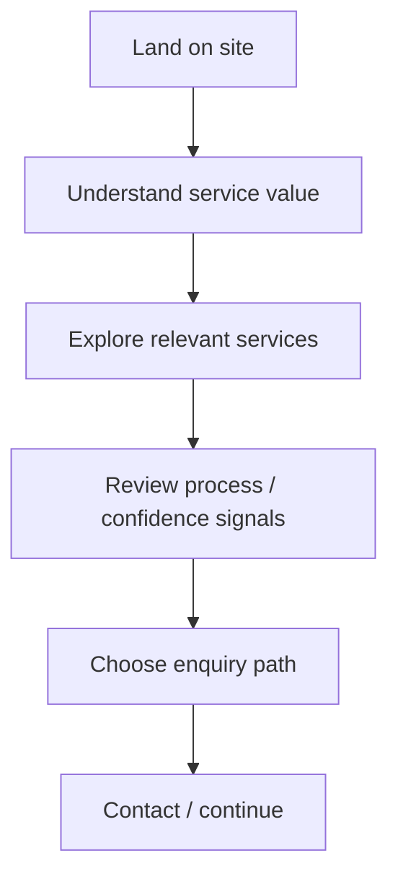
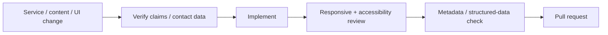

<div align="center">

# Totus Domum

**A concierge and property-stewardship website concept for presenting premium home, property, and lifestyle support through a clear service-led experience.**


[Browse source](https://github.com/Nischhalsubba/Totus-Domum/tree/main) · [Issues](https://github.com/Nischhalsubba/Totus-Domum/issues)

</div>

## Overview

**Totus Domum** is documented as a service website experience. Visitors should quickly understand the service proposition, see the types of property/lifestyle support available, build confidence, and reach a contact or enquiry path without needing a decoder ring for luxury-brand prose.

<details open>
<summary><strong>🏗️ Interactive service architecture</strong></summary>



</details>

## Visitor flow



## Audience guide

| Audience | Focus |
|---|---|
| Prospective clients | Services, trust and enquiry path |
| Developers | Structure, interactions, assets and delivery |
| Designers | Premium visual language, hierarchy, responsive behavior and accessibility |
| Content owners | Accurate services, geography, contact details and claims |

## Getting started

```bash
git clone https://github.com/Nischhalsubba/Totus-Domum.git
cd Totus-Domum
```

Use the project files, manifests and lockfiles to determine the current runtime and development commands.

## Design & accessibility

Premium does not require obscure. Keep service descriptions readable, navigation predictable, focus visible, imagery purposeful, layouts responsive, and motion optional. Contact/enquiry expectations should be explicit rather than implied through decorative wording.

## SEO & discoverability

Use accurate service and location terminology such as **property concierge, property stewardship, home management, concierge services, property care, and lifestyle support** only where supported by the actual business concept. Maintain unique titles/descriptions, semantic headings, Organization/Service structured data, canonical URLs, social metadata and meaningful image alternatives.

## Contribution flow




## Root-level Vite and GitHub Pages

The source `index.html`, TypeScript/React components, styles and `package.json` now live at repository root. Run `npm install && npm run check` from root. The GitHub Actions workflow publishes the **generated `dist/` directory**, preserving the existing Vite base `/Totus-Domum/`. The previous app README is archived in `docs/legacy-app-readme.md`.
